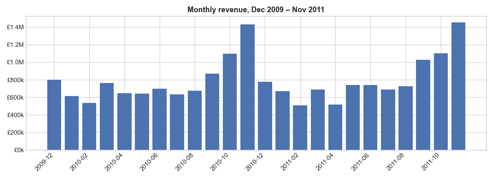
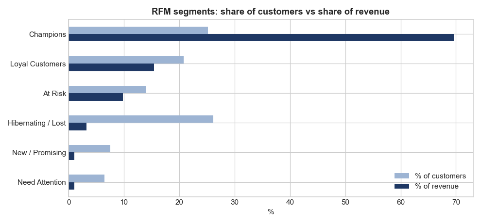
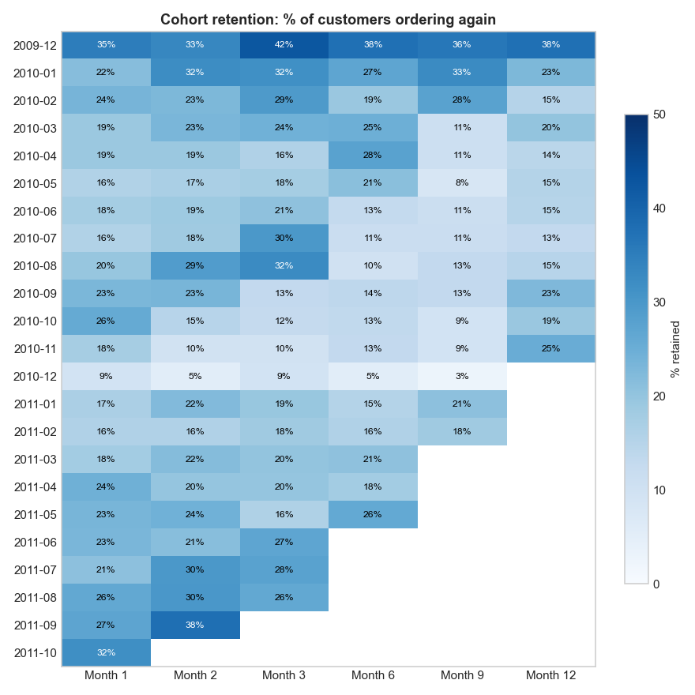
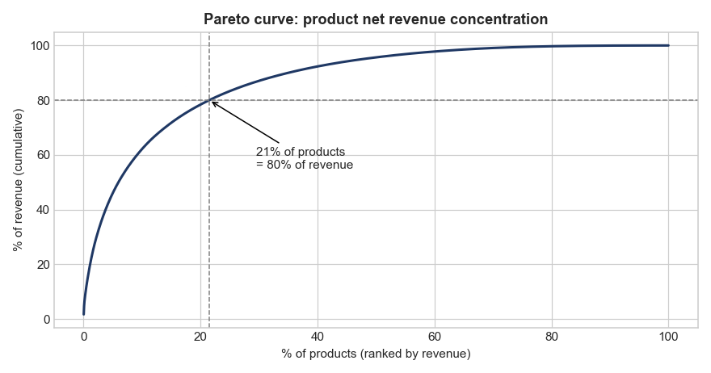

# E-commerce Customer & Sales Analytics in SQL

End-to-end SQL analysis of **1M+ real transactions** from a UK online retailer (Dec 2009 – Dec 2011). It covers data cleaning and modelling, sales performance, customer segmentation (RFM), cohort retention and product / basket analysis, with business recommendations.

**SQL skills used:** CTEs (incl. recursive) · window functions (`LAG`, `RANK`, `ROW_NUMBER`, `NTILE`, running `SUM() OVER`) · `CASE` logic · self-joins · conditional aggregation / pivots · subqueries · data modelling with `CREATE TABLE AS` + indexes

## Dataset

[Online Retail II](https://archive.ics.uci.edu/dataset/502/online+retail+ii), UCI Machine Learning Repository (CC BY 4.0): 1,067,371 invoice lines from a UK-based online gift retailer that sells mainly to wholesalers.

## Project structure

```
sql/
  01_data_cleaning.sql       data-quality checks, cleaning rules, data model
  02_sales_performance.sql   KPIs, monthly trend + growth, countries, weekday/hour patterns
  03_customer_analysis.sql   top customers, revenue concentration, repeat purchase, RFM, new vs returning
  04_cohort_retention.sql    monthly cohort retention matrix and retention curve
  05_product_analysis.sql    gross vs net revenue, top products, Pareto, return rates, bought-together pairs
results/                     output of every query (CSV) + RESULTS.md with all tables
images/                      charts built from query results
load_data.py                 loads the raw Excel file into SQLite, unchanged
run_analysis.py              runs all SQL files in order, saves results and charts
```

## Data cleaning & model (all in SQL)

Data-quality checks on the raw data found **19,494 cancellation lines, 243,007 rows with no customer ID (22.8%), 34,335 duplicate rows** (partly an overlap between the two source sheets) and **16 non-product codes** (postage, Amazon fees, bad-debt adjustments). Cleaning rules:

- Sales exclude cancelled invoices, returns, zero/negative prices and non-product codes; `SELECT DISTINCT` removes duplicates
- Cancellations are kept in a separate `returns` table so revenue can be reported **net of returns**
- Guest orders (no customer ID) count towards sales totals but are excluded from customer analysis

| Table | Rows | Grain |
|---|---|---|
| `transactions` | 1,003,417 | one clean sales line |
| `orders` | 39,516 | one invoice |
| `customers` | 5,852 | one identified customer |
| `products` | 4,902 | one stock code (gross & net revenue) |
| `returns` | 17,915 | one cancelled line |

## Key findings

**Sales performance**
- **£19.6M gross revenue, £18.9M net** after £716k of returns. 39,516 orders, average order value £497.
- **Strong Q4 seasonality:** November is the peak month in both years (£1.43M in 2010, £1.45M in 2011), about twice a typical month.
- **The UK brings in 85.5% of revenue**, but international orders are **84% larger** (average £853 vs £464), since they're mostly wholesale buyers.
- Orders peak at **midday (12:00–13:00, 30% of orders)** and on **Thursdays**; there's almost no trade on Saturdays.



**Customers**
- **Revenue is highly concentrated:** the top 10% of customers generate **63.9%** of revenue; customers with 11+ orders (14.8% of customers) generate **64.6%**.
- **RFM segmentation:** *Champions* are 25% of customers but **70% of revenue**. **815 "At Risk" customers** (good past buyers who haven't ordered for about a year) are worth **£1.68M** historically, the clearest win-back opportunity.
- **Returning customers drive the business:** about 90% of monthly revenue in 2011 came from returning customers. 27.6% of customers only ever ordered once.



**Retention**
- Roughly **1 in 5 customers orders again in any given later month** (19–25% across months 1–12).
- The **Nov 2010 cohort jumps to 25% retention at month 12**: seasonal Christmas buyers come back the following November.
- The Dec 2009 cohort looks unusually loyal because the data starts then, so it includes long-standing customers (left-censoring).



**Products**
- **Gross revenue gives a misleading picture:** two of the top-10 "best sellers" by gross revenue were bulk orders **cancelled almost entirely** (Paper Craft Little Birdie: 100% returned; Medium Ceramic Storage Jar: 95.5%). Ranking by **net** revenue removes them.
- **Pareto:** **21.5% of products generate 80% of net revenue**, and 6% generate half of it.
- **Bought together:** 63.5% of orders containing *Jumbo Bag Pink Polkadot* also contain *Jumbo Bag Red Retrospot*; 70% of *Red Hanging Heart T-light* orders include the white version. These are clear candidates for bundles and recommendations.



## Recommendations

1. **Run a win-back campaign for the 815 At-Risk customers** (£1.68M historical value) before the Q4 peak.
2. **Protect the Champions** (70% of revenue) with account management, early access to the Christmas range and volume pricing.
3. **Stock and staff for Q4** from September; re-target last November's buyers, who return seasonally.
4. **Create bundles** from the top bought-together pairs (jumbo bags, T-light holders, lunch bags, cake cases).
5. **Investigate high-return products** (several sit at around 49% return rates) and report revenue **net of returns** in management dashboards.

## How to run

```bash
pip install -r requirements.txt
# download online_retail_II.xlsx from the UCI link above into this folder
python load_data.py      # builds retail.db (SQLite) with the raw data
python run_analysis.py   # runs sql/01 to 05, writes results/ and images/
```

The SQL is written for **SQLite**, so no database server is needed. You can also open `retail.db` in **DBeaver** and run the `.sql` files directly. Date functions (`STRFTIME`, `JULIANDAY`) are the only SQLite-specific parts. In MySQL they would be `DATE_FORMAT` and `DATEDIFF`.

## Tech stack

SQL (SQLite) · Python (pandas, matplotlib) · DBeaver

## Author

**Abhay Rawat**, MBA (AI & Data Science), Graphic Era (Deemed to be University) · [LinkedIn](https://www.linkedin.com/in/abhay-rawat-4a79b52b4/) · [GitHub](https://github.com/abhay-017)
